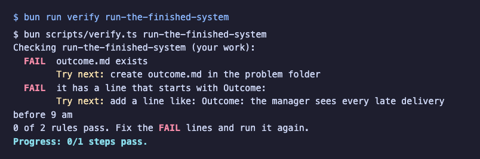

# Start here

You will set up the repo, meet the world, run the finished system and see the goal. It takes about 15 minutes.

```bash
bun install
```

Expect: `bun install` ends with no errors.

```bash
bun run verify run-the-finished-system
```

Expect: two `FAIL` lines, each with a `Try next:` line. That is the starting point; every step begins failing.



When a command prints something you do not expect, look it up in [troubleshooting.md](troubleshooting.md).
