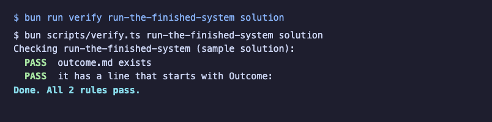
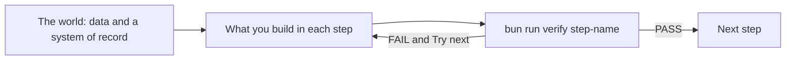

# Workshop template

The template every learnwithparam workshop repo starts from. Replace this README with the course's own.

## Run the finished system

```bash
bun run verify run-the-finished-system solution
```

Expect: `Done. All 2 rules pass.`





## How a course works

1. Start in [00-orientation](00-orientation/README.md).
2. Each part in `parts/` opens with a real problem and a diagram.
3. Each step has a challenge, a Done when list, and one command: `bun run verify <step-name>`.

The rules every course repo follows, and the check that enforces each one, are in [STANDARD.md](STANDARD.md).
