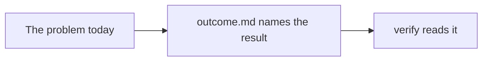

# Run the finished system

## The problem

Say what goes wrong in the world today and what it costs. For example: a bakery throws away 40 loaves a week.



## Watch it done

Show the before and after here, as a short clip or a screenshot with its real output. Before, `verify` prints two `FAIL` lines. After, it prints `Done.`

## Your turn

1. Write `outcome.md` in this folder with one line: the outcome you will build.

```text
Outcome: the baker sees tomorrow's orders on one page before 6 in the morning.
```

2. Run the check.

```bash
bun run verify run-the-finished-system
```

Expect: `Done. All 2 rules pass.` and a `Progress:` line.

If you see `FAIL outcome.md exists`, create `outcome.md` inside this `problem/` folder, not the repo root. If you see `FAIL it has a line that starts with Outcome:`, start the line with `Outcome:` and name one thing a person can see.

## Do it on your work

Write the same one line for your own project or files. Good looks like one thing a person can see, with a number.

## Done when

- `outcome.md` exists in this folder.
- It has one line that starts with `Outcome:`.

## Solution

The after state is one `outcome.md` file. See `solution/outcome.md` for the file and its diff.
