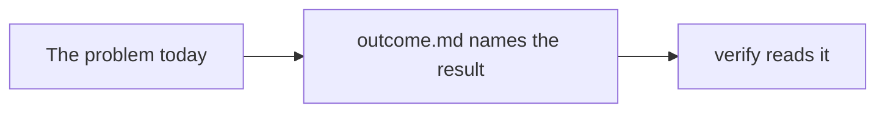

# Run the finished system

## The problem

Say what goes wrong in the world today, and what it costs.



## Your challenge

Write `outcome.md` with one line: the outcome you will build.

## Done when

- `outcome.md` exists in this folder.
- It has one line that starts with `Outcome:`.

```bash
bun run verify run-the-finished-system
```

Expect: `Done. All 2 rules pass.` and a `Progress:` line.

## If you get stuck

| What you see | Fix |
|---|---|
| `FAIL outcome.md exists` | Create `outcome.md` inside this `problem/` folder, not the repo root. |
| `FAIL it has a line that starts with Outcome:` | Start the line with `Outcome:` and name one thing a person can see. |

## Words you will use

- **Outcome**: the result a person can see when the work is done.
